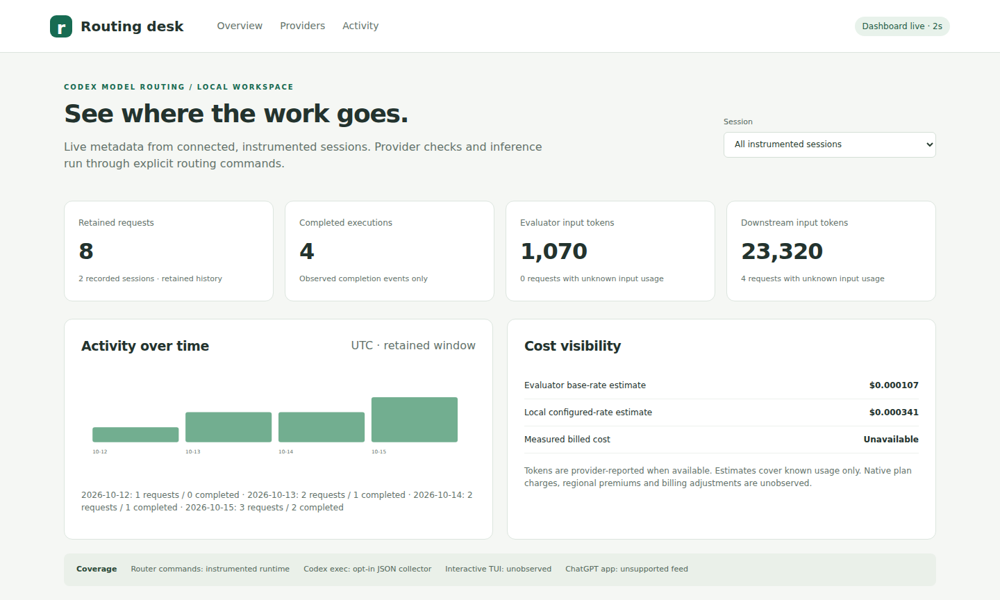
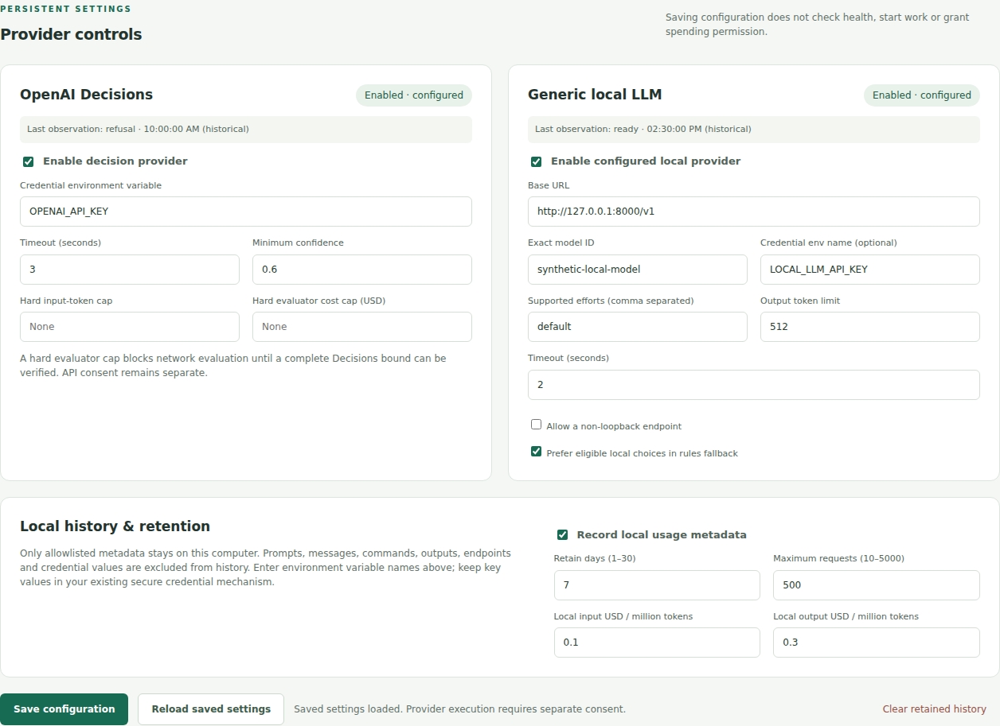
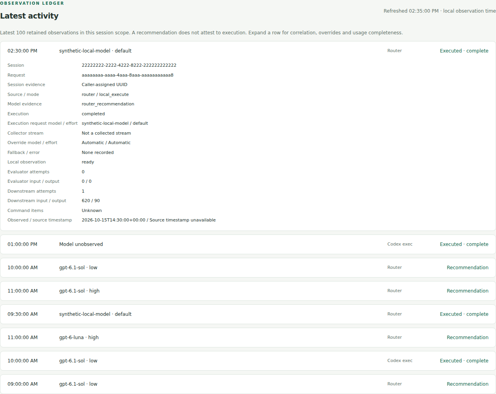

# Codex Model Routing

A Codex skill for choosing models, reasoning effort, and subagents to fit the task. It weighs capability, available usage, context transfer, and coordination costs, with a built-in option to delegate bounded subtasks to local LLMs.

Native Codex routing works with **no extra providers**. OpenAI Decisions and
generic local execution are independently optional and disabled by default.

| Local provider | Decisions | Behavior |
| --- | --- | --- |
| Off | Off | Parent's native model/effort recommendation; no provider request |
| On | Off | Configured, eligible local choices may join the native choices; rules select |
| Off | On | Decisions may select a native model/effort pair after explicit API consent |
| On | On | Decisions may choose from admitted native and configured local pairs |

Missing keys, unconfigured/offline providers, refusals and errors retain an
admissible recommendation. Explicit require-local requests, unsupported overrides
and hard ceilings fail closed when no route satisfies them. Recommendations do
not execute native work or authorize a paid fallback.

The complete portable entrypoint is included:

```powershell
# Windows: selects an existing Python 3.11+ runtime, skipping Store aliases.
powershell.exe -NoProfile -File .\scripts\Invoke-Routing.ps1 -PacketPath .\assets\routing-packet.example.json -Offline
```

```sh
# Unix, or use python3 scripts/routing_runtime.py with the same arguments.
sh scripts/invoke-routing.sh assets/routing-packet.example.json --offline
```

Set `CODEX_ROUTING_PYTHON` for an explicit existing interpreter. No SDK, tokenizer,
local server or key is required for the baseline. See
[portable providers and local execution](references/local-workers.md) for config,
secure credential options, readiness checks and bounded execution.

## Skill-first quickstart

Prerequisites: **Codex CLI and an existing Python 3.11+ interpreter**. No EXE,
SDK, Node package, local model server or API key is required. Git is optional:
clone below, or download and extract the repository ZIP before opening its folder.
The bootstrap installs no dependencies and changes no security permissions.

```sh
git clone https://github.com/peterjohannmedina/codex-model-routing.git
cd codex-model-routing
```

**Linux / macOS:**

```sh
sh scripts/bootstrap.sh install --start --open-browser
```

**Windows PowerShell:**

```powershell
powershell.exe -NoProfile -File .\scripts\bootstrap.ps1 -Command install -Start -OpenBrowser -Shortcuts
```

These commands explicitly install the skill, start its supporting background
dashboard process and request browser opening. Plain `install` starts nothing;
login startup and native telemetry remain off. No interactive CLI terminal needs
to stay open, but the background server must be running to serve the dashboard.
Its default URL is **http://127.0.0.1:8765**.

The skill lives at `$CODEX_HOME/skills/codex-model-routing` or
`~/.codex/skills/codex-model-routing`. Existing profiles, prompts, global
instructions, credentials and settings are preserved; missing native profile and
prompt templates are created as user-owned files. If the active Codex skill
catalog does not refresh, start a new chat. File verification alone does not prove
the current chat has discovered the skill.

Use `CODEX_ROUTING_PYTHON` or Windows `-PythonPath` to select an existing interpreter.
An unmanaged older install needs review and the explicit `--adopt-existing` /
`-AdoptExisting` choice; known package files are backed up. See
[bootstrap, safety and platform details](references/bootstrap.md).

### Copy this one-time setup prompt into Codex CLI

```text
Install https://github.com/peterjohannmedina/codex-model-routing as a Codex CLI
skill on this machine. Read its README, SKILL.md and references/bootstrap.md.
Use a fresh clone/download, preserve unrelated work, and check Codex CLI plus
an existing Python 3.11+ interpreter. Use scripts/bootstrap.ps1 on Windows or
scripts/bootstrap.sh on Linux/macOS with install, explicit start and browser-open
options. Windows user shortcuts are welcome. Do not silently install dependencies,
change security permissions, overwrite personal profiles/config/credentials,
enable login startup or native telemetry, make paid calls, or change my CLI model.

If an unmanaged install exists, inspect it and prepare its backup/adoption choice
before asking to use --adopt-existing. Never reset a dirty checkout. Run doctor
and status; verify the installed SKILL.md name/path, package integrity and managed
receiver. Use the installed open command again and verify it reuses the same
instance. If sockets or GUI access are blocked, report that stage without a
policy workaround or success claim. If the skill catalog needs a new chat, say so.

Report version/content revision, interpreter, skill path, dashboard URL, reopening
evidence, and open/status/stop/update/repair/rollback/uninstall commands. Distinguish
actual observations from demo data and recommendations from actual model switching.
```

The [reusable setup prompt](references/setup-prompt.md) has the same consent and
verification boundaries. The skill guides the parent agent; it does not silently
switch a CLI session whose model is pinned or start a Decisions API call on install.

### Reopen and manage the installed skill

On Linux/macOS, set a convenient path once in your shell:

```sh
router_home=${CODEX_HOME:-"$HOME/.codex"}
sh "$router_home/skills/codex-model-routing/scripts/bootstrap.sh" open
```

On Windows:

```powershell
$RouterHome = if ($env:CODEX_HOME) { $env:CODEX_HOME } else { Join-Path $HOME '.codex' }
$Router = Join-Path $RouterHome 'skills/codex-model-routing/scripts/bootstrap.ps1'
powershell.exe -NoProfile -File $Router -Command open
```

Use `status`, `doctor`, `start`, `stop`, `rollback` or `uninstall` in place of
`open` (Windows uses `-Command`). Reopening starts if needed and obtains a fresh
private browser handoff; it reuses the running server. The optional Windows
desktop/Start menu shortcuts do the same. There is no browser-profile editing:
authorize once, then bookmark the plain localhost URL with your browser's UI.
If a bookmark later needs authorization, use `open` again.

For updates, fetch/review the clone without discarding local changes, then run
its bootstrap with `update`. `repair` restores owned package files from that
reviewed source with a recovery backup. `rollback` restores the previous package
snapshot. Uninstall leaves profiles, prompts, history, credentials, user config
and backups, and never rewrites an existing telemetry exporter.

Optional next-login startup is an explicit `install/update --login-startup`
choice (Windows `-LoginStartup`). Remove it with `update --no-login-startup`
(Windows `-LoginStartup:$false`). No system service or privilege change is used.
Native telemetry needs its [separate approved setup](references/automatic-telemetry.md),
then `start --otel-receiver` (Windows `-OtelReceiver`). Installation never activates
the exporter. Credential settings take the name `OPENAI_API_KEY`, **not the secret**.
Keep key values in your existing secure mechanism; no credential or paid request
is required for the native baseline.

## Local dashboard and live observations



*Actual dashboard rendered in Chromium with synthetic demo data. The values are
illustrative; no provider calls, real account activity or measured bills were used.
These images document the initial dashboard release.*
See [capture provenance and reproduction steps](references/dashboard-screenshots.md).

<details>
<summary>Provider controls and activity screenshots (synthetic demo)</summary>



*Saved provider settings and historical observations. Saving settings does not
run inference or grant spending permission.*



*Synthetic activity with dummy identifiers and illustrative usage. A recommendation
is displayed separately from an observed execution.*

</details>

One localhost dashboard aggregates the instrumented runtime and opt-in Codex
exec JSON streams. It includes persistent provider controls, session drilldown,
retained daily totals, model/effort and override/fallback metadata, separate
evaluator/downstream usage, and labeled cost estimates. It refreshes every two
seconds without provider health checks or toggle-triggered execution.

The foreground launcher below remains available for diagnostics; for background
startup and reopening use the installed bootstrap's `open` command above.

```powershell
powershell.exe -NoProfile -File .\scripts\Start-RoutingDashboard.ps1 -OpenBrowser
```

```sh
sh scripts/invoke-routing.sh dashboard --open-browser
```

The launcher opens a private one-use authorization file, then the dashboard at
`http://127.0.0.1:8765`. Provider credentials are never read by the
dashboard. The instrumented runtime keeps a bounded local metadata ledger by
default (7 days / 500 requests), with disable/clear controls and no external
export. Existing older/private adapters, arbitrary already-open TUI sessions and
the ChatGPT app are unobserved. A recommendation does not switch a running CLI
model or prove execution. See [setup, privacy and supported sources](references/dashboard.md)
and the [dashboard requirements](references/dashboard-prd.md).

New local Codex CLI 0.162.1 sessions can also appear automatically through an
explicitly approved user-level OTel exporter. The local receiver retains only
allowlisted metadata and shows startup settings and model-response usage separately
from exec-turn totals. It is disabled by default; installation does not enable it
or replace existing exporters. See [automatic session pickup, privacy, activation
and undo](references/automatic-telemetry.md). Other app surfaces and ordinary
ChatGPT chats remain unverified or unsupported.

## Usage

The routing skill is intended to apply automatically to nontrivial work. It can also be invoked explicitly with:

```text
$codex-model-routing
```

The router chooses whether to keep work in the current session or delegate a bounded task. Native defaults are GPT-6 Luna (`high`), GPT-6.1 Sol (`low`, or `high` for expert work), and optional GPT-6 Astra (`low`). GPT-6 Sol remains a compatibility route. Availability and supported efforts depend on the active Codex catalog. `terra-general` remains an alias profile for existing callers and now uses GPT-6.1 Sol; new tasks should use `sol-general`.

## Decisions routing provider

An optional Python 3.11+ helper (standard library only) implements a provider
interface with offline rules and OpenAI Decisions. Decisions selects one complete
model/effort/action combination from prevalidated candidates, considering quality,
budget, token efficiency, latency, and context transfer. Direct-user model or
effort overrides take precedence over automatic selection; hard eligibility and
budget constraints still apply. "High intelligence" is a quality preference.

```sh
python scripts/routing_decision.py assets/routing-packet.example.json
python -m unittest discover -s tests -v
```

The default makes no API calls. Selecting `--provider decisions` also requires
`--allow-api` and an existing `OPENAI_API_KEY` in the environment. Installation
does not enable spending, obtain credentials, or change the user's main model.
Refusal, invalid output, network errors and timeout return the parent's safe
route. Recommendations do not execute work. See
[provider configuration, trust boundary and contract](references/decision-providers.md)
for enabling it after authorization, packet fields, provenance, budgets, costs,
and the remaining live-validation requirements.

See [implementation verification](references/verification-2026-10-15.md) for
the dated source evidence and offline checks performed for this change.

## Optional local LLM delegation

The router has built-in support for delegating subagent work to local LLMs. This is useful for self-contained tasks such as summarizing documents, classifying items, drafting text, reading code, or providing a second opinion. The main Codex session scopes the task, validates the result, and remains responsible for the final answer.

Connect a compatible local inference service or gateway using the bundled worker profiles and scripts. The router checks availability before assigning work and can prefer local capacity when it is suitable. If no configured local route is usable, work stays on an available native Codex route.

The routing prompt reports configuration by default:

```text
/prompts:codex-routing status
```

The public default local route uses a configured endpoint/model, with no Muse or Ganglion dependency. Existing deployments can still explicitly use the legacy capacity sweep, share-target helper and named profiles. See [Local LLM setup](references/local-workers.md) and the separate [legacy adapters](references/legacy-local-workers.md). Installation does not provision or contact an LLM server.

## Scope

Install the package once per Codex environment or user profile. Publishing or updating a repository does not update an existing installation; rerun the installer when you want to deploy a newer version.

Routing decisions do not change permissions. The optional `routing-bypass` profile is provided as a reference and is not enabled by the installer.
